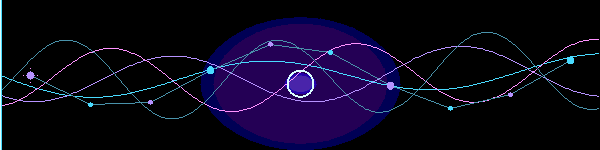
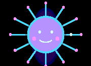

<div align="center">



# Eesha Munnangi

### Neuro-Electrophysiology · Computational Neuroscience · Neurotechnology

*Exploring neural signals, computational methods, and intelligent healthcare technologies.*

<a href="https://github.com/ItsEesha/eeg-signal-analysis">EEG RESEARCH LAB</a>
&nbsp; · &nbsp;
<a href="./projects/chatmed-ai/README.md">CHATMED AI CASE STUDY</a>
&nbsp; · &nbsp;
<a href="https://itseesha.github.io/ItsEesha/">LIVE INTERACTIVE PORTFOLIO</a>



</div>


## ◈ RESEARCH CONTROL SURFACE

| 🧠 RESEARCH IDENTITY | ⚡ NEURAL SIGNAL LAB | 🤖 HEALTHCARE AI |
|:---:|:---:|:---:|
| [Research interests](#01--research-identity) | [EEG project](https://github.com/ItsEesha/eeg-signal-analysis) | [ChatMed contribution](./projects/chatmed-ai/README.md) |
| [Clinical foundation](#05--clinical-foundation) | [Python source](https://github.com/ItsEesha/eeg-signal-analysis/blob/main/eeg_neurorobotics_project.py) | [Product website](https://www.chatmed.site/) |

<p align="center">
  <a href="https://itseesha.github.io/ItsEesha/"><b>OPEN LIVE INTERACTIVE PORTFOLIO ↗</b></a>
  &nbsp; · &nbsp;
  <a href="https://itseesha.github.io/ItsEesha/chatmed-ai.html"><b>CHATMED AI CASE STUDY PAGE ↗</b></a>
</p>


<a id="01--research-identity"></a>
## 01 / 🧠 Research Identity

I am a **Neuro-Electrophysiology graduate** with a clinical foundation in neurodiagnostic investigations and a growing focus on computational neuroscience, neural signal processing, and neuroengineering.

My interests lie at the intersection of **brain signals, machine learning, and intelligent technologies**. I am developing my computational skills through Python-based projects, scientific reading, and interdisciplinary healthcare AI work.

- 🧪 Clinical exposure to EEG, overnight Video EEG, Nerve Conduction Studies (NCS), Visual Evoked Potentials (VEP), and Somatosensory Evoked Potentials (SEP).
- ⚙️ Familiarity with neurophysiology workflows and Natus and Nicolet systems.
- 💻 Developing skills in Python, EEG preprocessing, feature extraction, and machine-learning workflows.
- 🤖 Contributing to ChatMed AI through medical information validation, AI output evaluation, beta testing, and Python-based backend/API integration.
- 🔭 Long-term research ambition: computational neuroscience and neurorobotics, especially intelligent systems that interpret and interact with neural activity.


<a id="02--research-domains"></a>
## 02 / 🔬 Research Domains

<table>
  <tr>
    <td width="33%" valign="top">
      <h3 align="center">🧠 Neural Systems</h3>
      <p align="center">Computational Neuroscience<br/>Systems Neuroscience<br/>Cognitive Functions<br/>Neural Oscillations</p>
    </td>
    <td width="33%" valign="top">
      <h3 align="center">⚡ Signals & Computation</h3>
      <p align="center">EEG Signal Processing<br/>Feature Extraction<br/>Machine Learning<br/>Neural Decoding</p>
    </td>
    <td width="33%" valign="top">
      <h3 align="center">🤖 Neurotechnology</h3>
      <p align="center">Brain–Computer Interfaces<br/>Neurorobotics<br/>Neuroengineering<br/>Neuroprosthetics</p>
    </td>
  </tr>
</table>


<a id="03--selected-projects"></a>
## 03 / 🚀 Selected Projects & Contributions

<table>
  <tr>
    <td width="50%" valign="top">
      <p align="center"><b>01 · EEG RESEARCH</b></p>
      <h3 align="center">EEG Signal Analysis for Neural Feature Extraction</h3>
      <p align="center">An exploratory Python workflow using the PhysioNet EEG Motor Movement/Imagery dataset. It explores EEG preprocessing, frequency-band feature extraction, and an initial subject-independent machine-learning evaluation.</p>
      <p align="center"><code>Python</code> · <code>MNE-Python</code> · <code>SciPy</code> · <code>scikit-learn</code></p>
      <p align="center">
        <a href="https://github.com/ItsEesha/eeg-signal-analysis"><b>OPEN EEG REPOSITORY ↗</b></a><br/>
        <a href="https://github.com/ItsEesha/eeg-signal-analysis/blob/main/eeg_neurorobotics_project.py">Python source code</a>
      </p>
    </td>
    <td width="50%" valign="top">
      <p align="center"><b>02 · HEALTHCARE AI CONTRIBUTION</b></p>
      <h3 align="center">ChatMed AI</h3>
      <p align="center">Eesha's contribution areas include medical information validation, AI output evaluation, beta testing, and Python-based backend/API integration. The case study maps the product journey and her scope without publishing private application code.</p>
      <p align="center"><code>Healthcare AI</code> · <code>AI Evaluation</code> · <code>Beta Testing</code> · <code>API Integration</code></p>
      <p align="center">
        <a href="./projects/chatmed-ai/README.md"><b>READ CONTRIBUTION CASE STUDY ↗</b></a><br/>
        <a href="./site/chatmed-ai.html">Animated case study page</a><br/>
        <a href="https://www.chatmed.site/">ChatMed website</a>
      </p>
    </td>
  </tr>
</table>


<a id="04--neural-signal-lab"></a>
## 04 / ⚡ Neural Signal Lab — EEG Workflow

```text
PHYSIONET EEGBCI
      │
      ▼
DATASET & EVENT INSPECTION
      │
      ▼
PREPROCESSING & EPOCHING
      │
      ▼
WELCH PSD / BAND-POWER FEATURES
      │
      ▼
EXPLORATORY SVM EVALUATION
      │
      ▼
PLOTS · FEATURE TABLES · RESULT SUMMARY
```

| Frequency band | Range used |
|---|---:|
| Delta | 1–4 Hz |
| Theta | 4–8 Hz |
| Alpha | 8–13 Hz |
| Beta | 13–30 Hz |

**Tools:** Python · MNE-Python · NumPy · Pandas · SciPy · Matplotlib · scikit-learn

> **Research note:** The current workflow uses one exploratory subject-independent group holdout. It is not a validated BCI, clinical diagnostic tool, or real-time robotic controller. Stronger research needs repeated group-aware validation, uncertainty estimates, and review of actual run outputs. No accuracy figures are claimed here.

<p align="center">
  <a href="https://github.com/ItsEesha/eeg-signal-analysis"><b>OPEN THE COMPLETE EEG REPOSITORY ↗</b></a>
</p>


<a id="05--clinical-foundation"></a>
## 05 / 🏥 Clinical Foundation

**Education**  
B.Sc. Neuro-Electrophysiology  
Shree Venkateswara College of Paramedical Sciences  
Affiliated with The Tamil Nadu Dr. M.G.R. Medical University

**Clinical training**  
Apollo Hospitals, Chennai — exposure to neurodiagnostic workflows, electrophysiological recording systems including Natus and Nicolet, and the importance of signal quality and artefact recognition.

| EEG | Video EEG | NCS | VEP | SEP |
|:---:|:---:|:---:|:---:|:---:|
| ✓ | ✓ | ✓ | ✓ | ✓ |


## 06 / 🧰 Technical Toolkit

| Area | Current focus |
|---|---|
| Programming | Python — developing |
| Scientific computing | NumPy, Pandas, SciPy |
| Neurophysiology | EEG, Video EEG, NCS, VEP, SEP |
| EEG analysis | MNE-Python, preprocessing, spectral features — developing |
| Machine learning | scikit-learn workflows — developing |
| Healthcare AI | Medical information validation, AI output evaluation |
| Integration | Python-based backend/API integration |

## 07 / 🌱 The Research Horizon

- Reproducible EEG preprocessing and analysis.
- Neural oscillations and cognitive functions.
- Machine learning for neural signals and neural decoding.
- Brain–computer interfaces and adaptive neural interfaces.
- Neurorobotics and AI-driven neuroengineering.

## 08 / 🤝 Collaboration

Interested in research discussions and interdisciplinary collaborations involving:

**EEG & neural signal processing · Computational neuroscience · Brain–computer interfaces · Neurorobotics · Neuroengineering · AI-driven healthcare**

<p align="center">
  <a href="https://github.com/ItsEesha">GitHub</a>
  &nbsp; · &nbsp;
  <a href="https://www.chatmed.site/">ChatMed AI</a>
  &nbsp; · &nbsp;
  <a href="./site/index.html">Portfolio source</a>
</p>

<div align="center">
  
  <br/>
  <sub>NEUROSCIENCE × COMPUTATION × ENGINEERING · Learning, building, and exploring — one experiment at a time.</sub>
</div>


