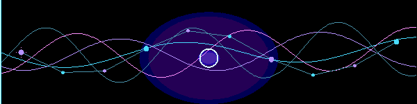

# ChatMed AI — Product Journey & Eesha's Contribution

**Healthcare AI · Medical Information Quality · Product Testing · API Integration**

[Visit ChatMed](https://www.chatmed.site/) · [Eesha's GitHub](https://github.com/ItsEesha)

**Project website:** https://www.chatmed.site/  
**Portfolio owner:** Eesha Munnangi  
**Project area:** Healthcare AI · Medical information quality · AI evaluation · Product testing · Backend/API integration

> **Contribution scope:** This case study describes the ChatMed product journey visible in the supplied application snapshot and separates that product scope from Eesha's stated contribution areas. It does not claim that Eesha independently founded, architected, or implemented every part of the product.

---

## 1. Product context

ChatMed AI is a healthcare-focused conversational AI product. The supplied application codebase shows a user-facing experience organised around medical AI chat, voice interaction, medical tools, health-related pages, and supporting account and product workflows.

The product direction brings together three practical goals:

- Make health information easier to access through a conversational interface.
- Support different interaction patterns, including typed chat and voice.
- Connect the user experience to supporting health tools, documentation, account, and API workflows.

The live product is available at [chatmed.site](https://www.chatmed.site/).

## 2. Product journey — from concept to working application

The sequence below summarises the product lifecycle represented by the application snapshot. It is a product-level view, not a claim that one contributor delivered every stage alone.

| Stage | Product work | Eesha's contribution |
|---|---|---|
| 01 — Product understanding | Understand the healthcare use case, user journeys, and intended product experience. | Build product context and take part in discussions around the medical-information and user-experience needs relevant to her role. |
| 02 — Feature planning | Shape the main experience around medical chat, voice assistance, medical tools, and supporting user workflows. | Bring a neuro-electrophysiology perspective to medical terminology, context, and information review. |
| 03 — Application execution | Implement the application experience and connect its pages, services, and supporting workflows. | Support Python-based backend/API integration within her assigned scope. |
| 04 — Medical information & AI review | Review the usefulness, clarity, and appropriateness of healthcare-oriented information and generated responses. | Validate medical information and evaluate AI-generated outputs; flag issues for review rather than treating model output as clinical advice. |
| 05 — Beta testing | Exercise user journeys, identify rough edges, and report bugs or confusing behaviour. | Participate in beta testing and provide feedback from a healthcare/neurophysiology-informed perspective. |
| 06 — Iteration | Use testing and review feedback to guide refinements to the product experience. | Re-test relevant flows and contribute feedback and integration support as changes are made. |

## 3. Product capabilities visible in the supplied codebase

The reviewed React application contains routes and modules for:

- **Medical AI chat** — a dedicated conversational chat experience.
- **Voice assistant** — a voice interaction page and a WebSocket-based voice session service.
- **Medical tools** — a dedicated medical-tools page.
- **Health and CareOS experiences** — health-related and CareOS pages.
- **User workflows** — authentication, email verification, profile, settings, and protected pages.
- **Product and developer information** — features, pricing, blog, documentation, API information, and an API dashboard.
- **Payments** — payment and payment-success routes with Stripe-related frontend dependencies.
- **Internationalisation** — an i18next-based language infrastructure.
- **Progressive web application support** — a Vite PWA setup with auto-update behaviour.

These points describe application structure found in the supplied snapshot. They are not independent verification of every production feature, deployment, user count, or service-level claim on the public website.

## 4. Technical architecture observed

The supplied frontend snapshot uses the following technologies and patterns:

| Layer | Technologies / implementation visible in the snapshot |
|---|---|
| Frontend application | React 18, TypeScript, Vite |
| Navigation | React Router with lazy-loaded page modules |
| UI and motion | Radix UI components, Framer Motion, GSAP, Lenis |
| Authentication | Firebase authentication integration |
| API communication | Axios and service modules |
| Voice interaction | Browser microphone capture and WebSocket streaming service |
| Localisation | i18next and React i18n integration |
| Payments | Stripe frontend SDK dependencies |
| Visualisation and interactive UI | Recharts, Three.js, React Three Fiber |
| Build and delivery | TypeScript checks, Vite build, gzip/Brotli compression, PWA configuration, sitemap/prerender scripts |

### Healthcare-oriented safeguards in the snapshot

The reviewed code includes a lightweight medical-ethics helper that checks message text for selected emergency/urgent keywords and prescription-related patterns, then produces cautionary guidance.

This is a rule-based helper in the supplied frontend snapshot. It should not be represented as a clinically validated triage system, a diagnostic engine, or a substitute for professional medical assessment.

## 5. Eesha's role and contribution

Eesha's contribution is centred on the intersection of clinical context and product execution:

### Medical information validation
Review medical information for terminology, context, and clarity, drawing on her neuro-electrophysiology education and clinical training exposure.

### AI output evaluation
Evaluate AI-generated responses for relevance, clarity, and potential issues. Feedback is for product improvement and review; it does not confer clinical decision-making authority.

### Beta testing
Test product flows, report unexpected behaviour, and provide feedback on the experience from a healthcare-informed user perspective.

### Python-based backend/API integration
Support assigned backend/API integration tasks using Python, helping connect product requirements with implementation workflows.

### Cross-functional collaboration
Work across healthcare context, product feedback, testing, and technical integration so that issues discovered in one stage can inform the next iteration.

**Role boundary:** This portfolio describes Eesha's stated responsibilities. It does not claim she independently built the complete ChatMed application, authored every AI component, or owns the product.

## 6. How the contribution connects to Eesha's research direction

ChatMed AI gives Eesha an applied setting to explore questions adjacent to her longer-term interests:

- How can healthcare information be reviewed for clarity and context?
- How should AI-generated health information be evaluated before user-facing release?
- How can software workflows connect healthcare requirements to technical implementation?
- How can interdisciplinary feedback improve AI-enabled product experiences?

This work complements her developing interests in computational neuroscience, neural signal analysis, and AI-driven healthcare.

## 7. Responsible disclosure

This repository page is a **portfolio case study**, not a copy of the ChatMed source repository.

The supplied ZIP contains application source and project configuration. The source snapshot identifies the package as private and does not include a public open-source licence. Accordingly, this portfolio does not republish the source code, private prompts, environment files, credentials, internal configuration, patient information, or confidential material.

Only Eesha's approved contribution summary and high-level product/technology observations are shared here. Additional implementation details should be published only with the project owner's permission.

---

## Project link

- **ChatMed AI website:** https://www.chatmed.site/

**Eesha Munnangi**  
Neuro-Electrophysiology · Healthcare AI · Computational Neuroscience
